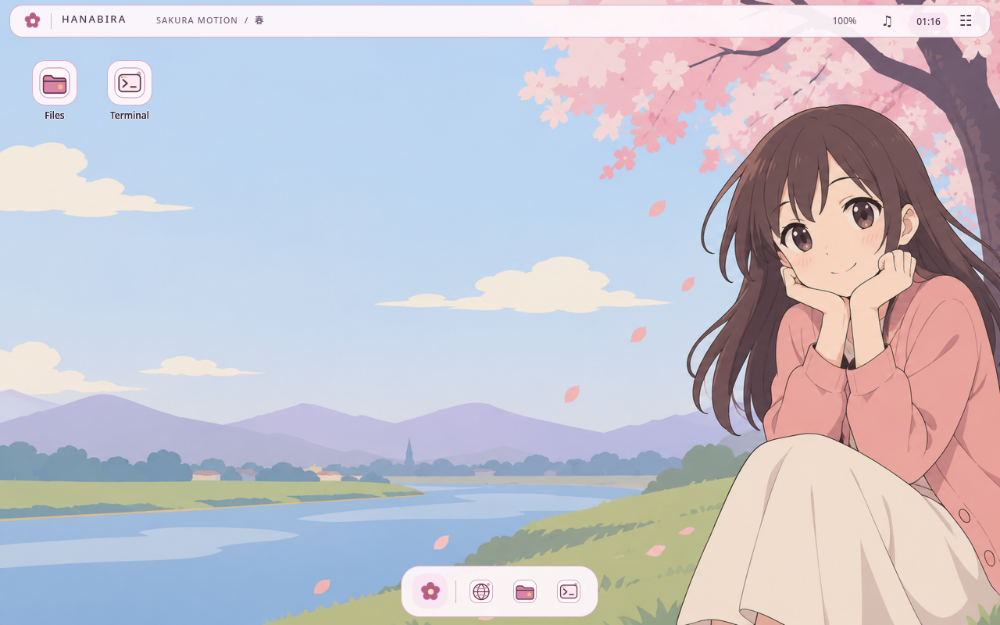
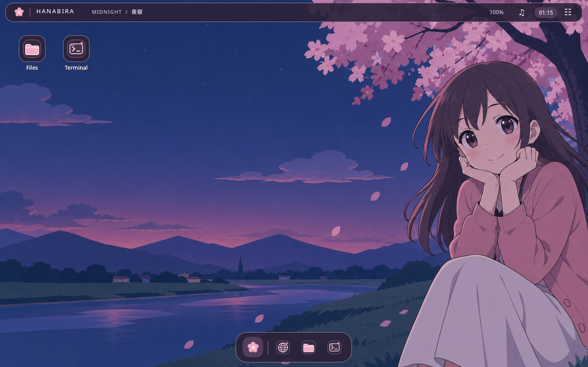
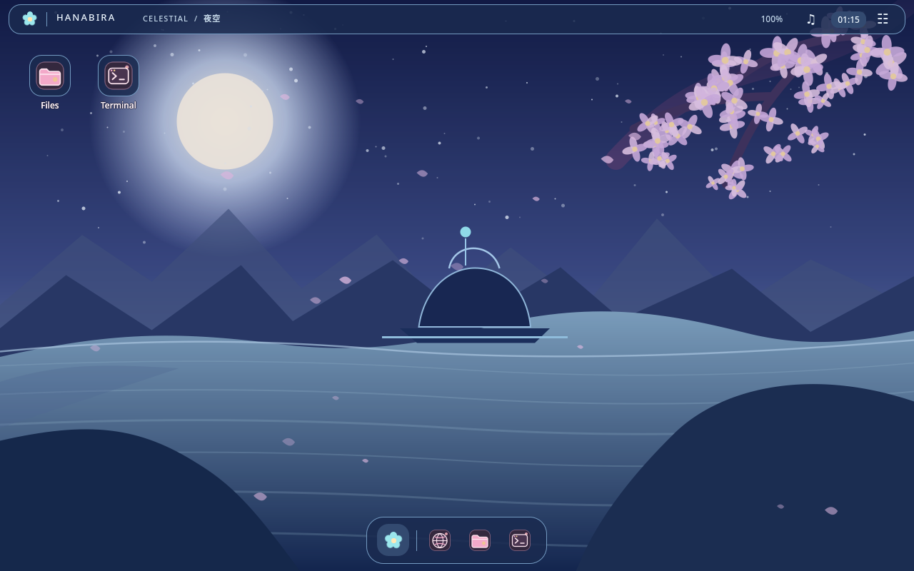
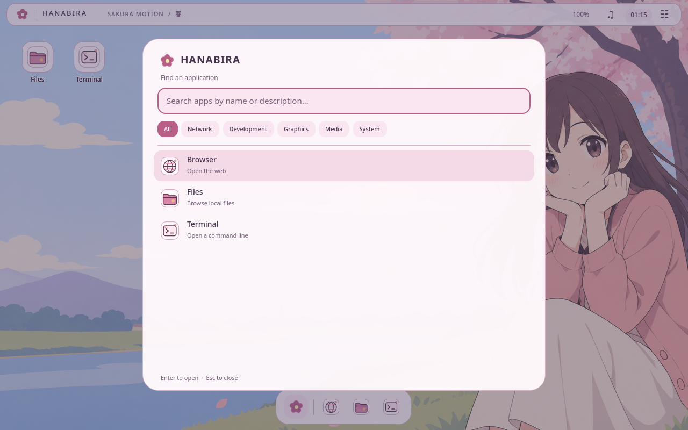
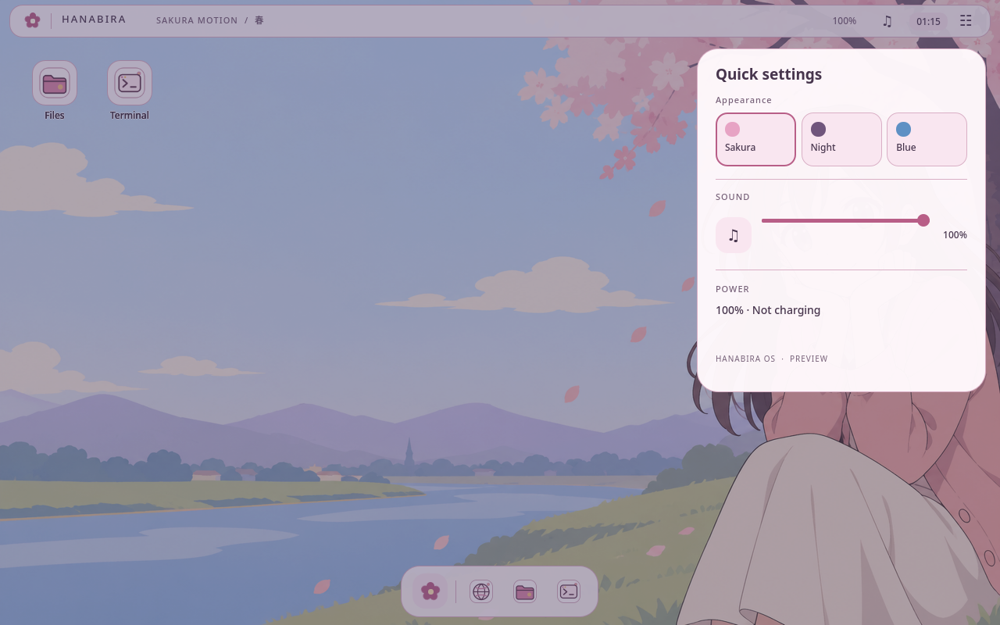

# Working HDE slice — 2026-10-15

These are development results. They do not establish production readiness.

- Source checks and core Rust tests passed (5 tests: time-based motion,
  refresh independence, reduced motion, invalid inputs and frame stalls).
- Compositor builds/checks/tests passed with Rust 1.85.1 (Debian-compatible
  dependency pins). Two CLI parser tests passed. Real Alacritty and GTK Wayland
  clients completed configure/commit/frame callbacks in the nested EGL backend.
- Actual Smithay GLES framebuffer captures showed the Qt layer-shell
  wallpaper/panel/dock and a live Alacritty window in correct stacking order.
  D-Bus `ToggleLauncher` opened the actual launcher overlay in that compositor.
- The NVIDIA nested EGL driver rejects buffer-age queries on this host.
  The compositor now probes once and uses full repaint on damaged frames when
  unsupported. No repeated buffer-age query loop remains. Native DRM is not
  implemented; `--backend drm` explicitly returns failure.
- Shell host builds and self-test passed. Isolated `.desktop` search found a
  fixture and its Exec launch created an actual marker. Three themes and small
  layouts were inspected. MPRIS metadata and asynchronous playback controls are
  backed by the real session bus, with capability-disabled buttons.
- Five actual `.deb`s (compositor, shell, session, installer, tools) built in
  Debian 13; APT resolved them together in a fresh trixie container.
- Calamares loaded its branded configuration and 8 view steps in a disposable
  offscreen Debian container without QML/FATAL errors. The installer refused
  to run on the development host. This is not a completed disk installation.
- `./scripts/build-iso.sh` succeeded and checksum/BIOS/UEFI boot catalog checks
  passed. Integration artifact SHA-256:
  `1feeb2eee6248a1ab3fca4284da02d6e1657166e767bd44e23c076df70b7b52f`.
  It is 1735 MiB. Notice packaging and icon-cache fixes landed after this build;
  rebuild before public binary release. Live/installed VM journey is pending.

## Visual evidence

These isolated captures render the real native shell in offscreen QA mode.
They are visual checks, not boot or FPS measurements.

| Sakura Dream | Midnight Hanabira |
| --- | --- |
|  |  |

| Celestial Blue | Launcher |
| --- | --- |
|  |  |

An event-driven startup/idle capture produced a small number of submitted
frames over several seconds. Its long idle intervals are intentional and
must not be reported as sustained animation FPS or dropped physical refreshes.
No 240 FPS, input latency or idle wattage claim has been measured yet.

See REQUIREMENTS.md for every open acceptance gate. A full third-party Rust
license inventory was recorded at pinned upstream revisions; `drm-fourcc`
still lacks a shipped notice text and needs review before public binary release.
